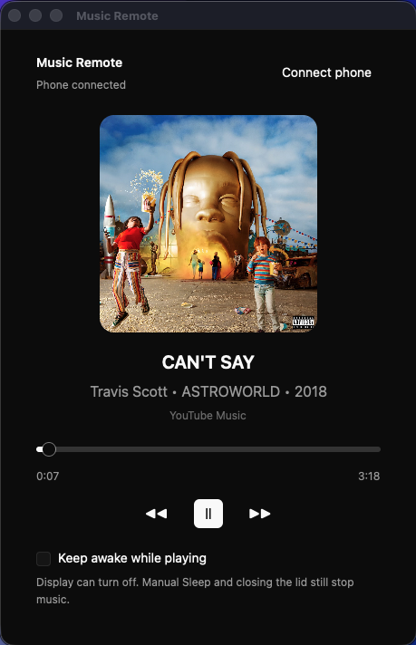
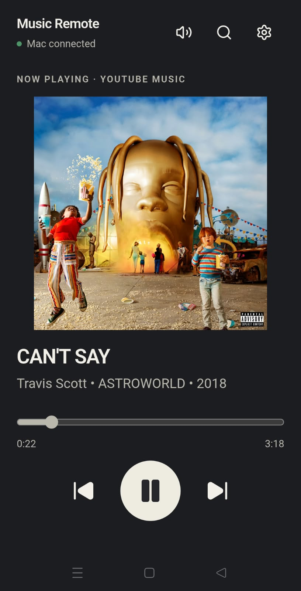

# YouTube Music Remote

<p>
  
  
</p>

Control YouTube Music on your Mac from your phone. Music plays on the Mac; your phone is the remote, not an audio streaming destination.

The desktop agent controls an existing YouTube Music tab in Chrome. The installable PWA sends commands through your self-hosted relay. Album artwork shown in the screenshots belongs to its respective owners.

## What works

- Play, pause, previous, next, and seeking
- Phone volume slider for the YouTube Music tab, independent of other Mac audio
- Vertical Music and Mac volume sliders, opened from the speaker button in the PWA header
- Separate Mac output-volume control, affecting all system audio; hidden when unavailable
- Search songs from the phone and play a result in the existing YouTube Music tab
- Current title, artist, artwork, duration, and playback position
- YouTube Music stays selected when another Chrome tab starts playing media
- A native GPUI desktop player with live media updates
- Compact now-playing controls remain available while browsing phone search results
- Optional **Keep awake while playing** checkbox in the desktop agent
- Light and dark appearance support
- MediaRemote compatibility checks on macOS
- A Cloudflare relay and installable phone PWA connected through desktop pairing

## How it works

1. Run the desktop agent and open YouTube Music in Chrome on your Mac.
2. Deploy your own relay and PWA using the steps below.
3. In the desktop agent, select **Connect phone**, enter your relay URL, and create a pairing code.
4. Open the PWA on your phone and enter the same relay URL and pairing code.
5. Control playback, search for songs, or tap the speaker button to adjust volume. Keep the desktop agent running.

There is no shared hosted relay: each user deploys their own. The relay carries commands and player metadata, not music audio.

## Limitations

- The Mac must stay awake and connected to the internet, with the desktop agent running. Manual Sleep and lid-close sleep interrupt playback and phone control.
- Chrome needs **View → Developer → Allow JavaScript from Apple Events** enabled. macOS may also ask you to allow the agent to control Chrome.
- Search currently supports songs, not playlist browsing or playlist search. Selecting a result plays it in the existing Music tab.
- Some audio outputs do not expose Mac system-volume control. Music volume remains separate from Mac output volume.
- YouTube Music is the primary target. MediaRemote provides a fallback for other players, but YouTube Music search and tab-specific controls do not apply to them.
- The desktop bundle is ad-hoc signed, not notarized. The PWA is currently tested on Android; other mobile platforms are not verified.

## Requirements

- Node.js 20 or newer
- pnpm 10
- Rust 1.92 or newer
- CMake and Xcode Command Line Tools (source builds only)
- A free Cloudflare account

## Install and verify

```sh
pnpm install
pnpm typecheck
pnpm build
pnpm desktop:check
```

Create a self-contained, ad-hoc signed macOS application with `pnpm desktop:bundle`. End users of the bundle do not need Homebrew, CMake, Rust, or `media-control`.

### Keep awake while playing

Enable **Keep awake while playing** in the desktop agent to prevent idle system sleep during playback. The display can still turn off, and the Mac can stay locked. Protection is released when playback pauses or stops, media-state reading fails, the checkbox is cleared, or the agent exits. The checkbox starts unchecked each launch; it does not change macOS power settings permanently.

This does not override **Apple menu → Sleep**, closing the lid, or macOS safety-related sleep. Keeping the Mac awake uses more battery than sleep. Leave the agent running and use **Lock Screen**, rather than Sleep, when controlling music from your phone.

## Deploy the relay

Authenticate Wrangler and deploy the Worker and its Durable Objects:

```sh
pnpm --filter @yt-remote/relay exec wrangler login
pnpm --filter @yt-remote/relay deploy
```

Keep the resulting `https://…workers.dev` URL. The default configuration uses only free-tier Cloudflare services.

Select **Connect phone** in the desktop app, paste that URL, and create a six-digit code.

For local relay development:

```sh
pnpm --filter @yt-remote/relay dev
```

## Deploy the PWA

Build the static site:

```sh
pnpm --filter @yt-remote/web build
```

Deploy `apps/web/dist` to Cloudflare Pages or any HTTPS static host. For Cloudflare Pages with Wrangler:

```sh
pnpm --filter @yt-remote/relay exec wrangler pages deploy ../../apps/web/dist
```

Open the deployed URL on your phone, enter the relay URL and desktop pairing code, then use the browser's **Add to Home screen** action.

## Architecture

```text
Phone PWA ⇄ WSS ⇄ Cloudflare Worker / Durable Object ⇄ WSS ⇄ Rust desktop agent
                                                                         ├─ YouTube Music tab in Chrome
                                                                         └─ MediaRemote fallback
```

The shared `@yt-remote/protocol` package validates messages at the relay boundary. A room accepts commands only from the paired remote and state updates only from the desktop app. Pairing attempts are limited to ten per IP address per five minutes. Tokens are stored as SHA-256 hashes in Durable Object storage.

## Workspace

```text
apps/desktop    Rust media controller, GPUI app, and relay client
apps/relay      Cloudflare Worker and Durable Objects
apps/web        React, Tailwind CSS, shadcn-style PWA
packages/protocol  Shared messages and validation
```

## License

MIT
